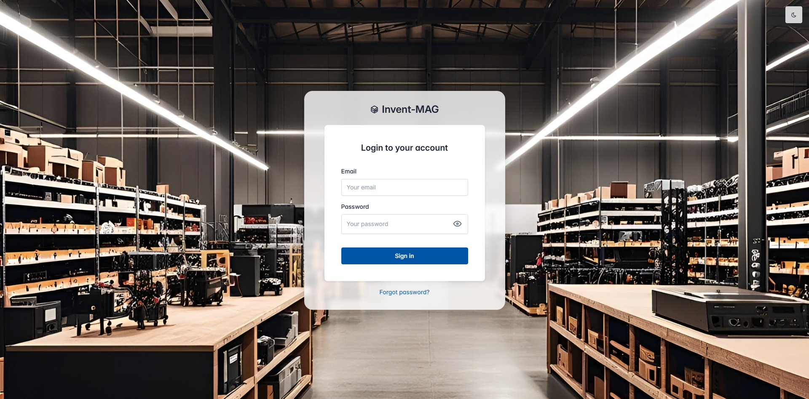

# Invent-MAG: Enterprise Inventory & Accounting System

**Version:** 2.1  
**Author:** moogie3  
**License:** Apache-2.0  
**Development Time:** 1.5+ years (451+ commits)  
**Status:** Production-Ready

---

## 📊 Project Statistics

| Metric               | Value                                        |
| -------------------- | -------------------------------------------- |
| **🏗️ Architecture**  | Multi-tenant SaaS                            |
| **🧪 Test Coverage** | 1099 tests / 3317 assertions                |
| **💻 Codebase**      | 451+ commits, 1.5 years development          |
| **🔐 Security**      | RBAC with 101 permissions, audit logging      |
| **🐳 DevOps**        | Docker + GitHub Actions CI/CD                |
| **📡 API**           | RESTful API with Sanctum authentication      |
| **🌍 Multi-tenancy** | Subdomain-based SaaS (`*.invent-mag.web.id`) |

---

## 📘 Introduction

Invent-MAG is a comprehensive, enterprise-grade ERP system designed for modern businesses. Built on Laravel 11 with 1.5 years of continuous development, it combines inventory management, sales & purchase operations, customer relationship management (CRM), supplier relationship management (SRM), and a complete double-entry accounting suite into a single, cohesive platform.

Unlike basic inventory systems, Invent-MAG provides **sophisticated business intelligence** including sales forecasting using Holt-Winters algorithms, automated financial reporting, and comprehensive audit trails for compliance.



---

## 🚀 Live Demo & Credentials

Experience Invent-MAG firsthand:

- **URL:** `https://invent-mag.web.id`
- **Demo Starter:** `https://demo-starter.invent-mag.web.id/admin/login` (starter@demo.com / password)
- **Demo Professional:** `https://demo-pro.invent-mag.web.id/admin/login` (pro@demo.com / password)
- **Demo Enterprise:** `https://demo-enterprise.invent-mag.web.id/admin/login` (enterprise@demo.com / password)
- **Super User:** `superuser@example.com` / `password` (Depends on tenant context)

---

## ✨ Complete Feature List

### **📦 Inventory & Product Management**

#### Core Features

- **Product Catalog:** Full CRUD with images, categories, descriptions
- **Multi-Warehouse Support:** Track stock across unlimited warehouses
- **Real-time Stock Control:** Live inventory levels per warehouse
- **Stock Adjustments:** Auditable adjustments with reason codes
- **Low Stock Alerts:** Per-warehouse threshold notifications
- **Unit Management:** Multiple units of measure per product

#### Advanced Inventory Features

- **Product Expiry Tracking:** Monitor and alert on expiring products
- **Barcode Search:** Quick product lookup via barcode scanning
- **Stock Adjustment Audit Trail:** Before/after quantities, user tracking
- **Bulk Operations:** Delete, export, and update stock in bulk
- **Per-Customer Pricing:** Historical pricing per customer
- **Stock Opname (Physical Count):** Scheduled inventory counts with variance tracking, accounting integration

#### Stock Opname & Audit (Professional+)

- **Scheduled Counts:** Plan physical inventory counts by date and warehouse
- **Multi-Warehouse Support:** Count across multiple warehouses
- **Variance Auto-Calculation:** System calculates shortage/excess automatically
- **Inventory Adjustment:** Auto-posts to stock levels on completion
- **Accounting Integration:** Creates journal entries for shortages (expense) and excess (revenue)
- **Audit Trail:** Full history of all counts and adjustments

#### Stock Transfer (All Plans)

- **Warehouse-to-Warehouse Transfer:** Move stock between warehouses with quantity and reason entry
- **Real-Time Stock Display:** Shows available quantity for each product when selecting source warehouse
- **Automatic Adjustment:** Source warehouse decremented, destination warehouse incremented automatically
- **Dual Audit Records:** Two StockAdjustment records created with `adjustment_type = 'transfer'`
- **Adjustment Log Integration:** All transfers visible in the adjustment log report
- **Linked from Product Edit:** Quick access to stock transfer from product warehouse stock section

---

### **💰 Sales & Customer Management (CRM)**

#### Sales Operations

- **Sales Order Management:** Full lifecycle from quote to payment
- **Point of Sale (POS):** Dedicated interface with receipt printing **(All Plans)**
- **Multiple Payment Methods:** Cash, card, transfer per transaction
- **Sales Returns:** Complete returns workflow with configurable accounting entries **(All Plans)**
- **Invoice Generation:** PDF invoice creation
- **Consistent Payment Status Labels:** Paid, Partially Paid, Unpaid (Pending / Due Today / Due in X Days / Overdue), Returned
- **Customer Credit Notes:** Auto-created when return is Completed AND original invoice is Paid

#### Quotation Management **(Professional & Enterprise)**

- **Quotation CRUD:** Create, edit, view, and delete quotations with full line-item management
- **Status Lifecycle:** Draft → Sent → Accepted → Converted (or Rejected/Expired → Draft recycle)
- **Quotation PDF Generation:** Professional PDF documents via DomPDF
- **Convert to Sales Order:** Accepted quotations convert seamlessly to sales orders
- **Pipeline Integration:** Generate quotations directly from Sales Pipeline opportunities
- **Notes & Terms Conditions:** Free-text fields for customer-facing instructions and legal terms
- **Financial Calculations:** Per-item and order-level discounts (%/fixed), tax (exclusive/inclusive/none)
- **Bulk Operations:** Bulk delete and CSV export
- **Quotation Number Auto-generation:** Sequential format QTN-YYYYMMDD-XXXX

#### Customer Intelligence

- **Customer Database:** Full profiles with interaction history
- **Purchase History:** Complete customer transaction records
- **Customer Lifetime Value (LTV):** Net calculation subtracting returned items
- **Customer Retention Analysis:** Loyalty tracking
- **Accurate Product Mix:** Adjusts for returned products over lifetime
- **Per-Customer Pricing:** Historical price tracking

#### Advanced CRM Features

- **Sales Pipeline:** Kanban-style opportunity management
- **Pipeline Stages:** Customizable stages with drag-and-drop
- **Opportunity Tracking:** Value, probability, expected close dates
- **Quotation PDF Generation:** Generate professional Quotation/Estimate PDFs directly from the pipeline
- **Pipeline Conversion:** Convert opportunities to sales orders
- **Interaction Tracking:** Log calls, emails, meetings, notes

#### Sales Analytics

- **Sales Forecasting:** ⭐ **Holt-Winters algorithm + Linear Regression**
    - Predicts future sales based on historical data
    - Seasonal trend analysis
    - Accuracy metrics
- **Sales Metrics:** Real-time dashboard KPIs
- **Collection Rate:** Automated performance tracking

---

### **🛒 Purchase & Supplier Management (SRM)**

#### Purchase Operations

- **Purchase Order Management:** Full CRUD with stock reconciliation
- **Multi-warehouse Receiving:** Receive to specific warehouses
- **Purchase Returns:** Complete returns to suppliers with stock and accounting adjustments **(All Plans)**
- **Expiry Date Tracking:** Monitor product expiration dates
- **Consistent Payment Status Labels:** Paid, Partially Paid, Pending (Due Today / Due in X Days / Overdue), Returned
- **Autofill Info:** Past price & due date auto-filled from supplier history on PO creation

#### Supplier Intelligence

- **Supplier Database:** Profiles with interaction history
- **Purchase History:** Complete supplier transaction records
- **Supplier Analytics:** Performance tracking
- **Interaction Tracking:** Log all supplier communications

---

### **💳 Subscription & Payment System**

#### Subscription Tiers

- **Starter Plan:** Basic features, limited users (3), warehouses (1), products (100) - $19/mo
- **Professional Plan:** Advanced features, higher limits (10 users, unlimited warehouses, 500 products), includes **Stock Opname**, Accounting, CRM, HR & Payroll - $59/mo
- **Enterprise Plan:** Full access, unlimited users, warehouses, products, plus sales forecasting, RESTful API, and audit trail - $109/mo

#### Features

- **Feature-Gated Access:** Route middleware blocks features not in user's plan
- **Usage Limits:** Enforced per-plan limits for users (3/10/Unlimited), warehouses (1/5/Unlimited), products (100/500/Unlimited)
- **Midtrans Integration:** Secure payment processing
- **Dynamic Pricing:** USD displayed, IDR charged (Indonesian market)
- **Invoice Emails:** Automatic receipt sent on successful payment
- **Plan Badges:** Current tier displayed in sidebar

#### Payment Flow

1. User selects plan on upgrade page
2. Redirected to checkout with invoice details
3. Midtrans Snap popup for credit card payment
4. Frontend confirms payment → Plan updated immediately
5. Webhook serves as backup verification

---

### **📊 Financial & Accounting Suite**

#### Chart of Accounts

- **Hierarchical COA:** 35+ pre-configured accounts
- **Account Types:** Assets, Liabilities, Equity, Revenue, Expenses
- **Contra Accounts:** Support for accumulated depreciation, allowances
- **Manual Entry Control:** Per-account permissions

#### Journal Entry System ⭐

- **Manual Journal Entries:** Full CRUD with multi-line support
- **Status Workflow:** Draft → Posted → Void
- **Balance Validation:** Automatic debit/credit balancing
- **Journal Reversal:** One-click reversal with automatic entries
- **Voiding:** Soft delete with audit trail
- **Audit Trail:** Complete change history for compliance
- **Audit Log Sidebar:** Role badges correctly styled per user role

#### Core Accounting

- **General Journal:** All financial transactions
- **General Ledger:** Account-level transaction history
- **Trial Balance:** Automated balancing validation

#### Financial Reporting

- **Income Statement:** P&L with customizable periods
- **Balance Sheet:** Financial position snapshot
- **AR Aging Report:** Outstanding receivables (Current, 1-30, 31-60, 61-90, 90+ days)
- **AP Aging Report:** Outstanding payables (same buckets)
- **Cash Position:** Current cash across accounts
- **Cash Flow Statement:** Operating, investing, and financing activities with PDF/CSV export

#### Advanced Accounting Features

- **PPh (Withholding Tax):** Support for PPh 21, 22, 23, and 25 withholding tax calculations and reporting.
- **Double-Entry Bookkeeping:** Strict automated journal entry creation with dynamic **FIFO (First-In, First-Out) Cost of Goods Sold (COGS)** calculation.
- **Automated Reversals:** Deleting a Sale, Purchase, or Return automatically reverses the associated Journal Entries to maintain a perfectly balanced General Ledger.
- **Accurate GL Summaries:** Real-time dashboards correctly deduct Sales Returns and Purchase Returns from Revenue and Expense totals.
- **Multi-Currency Support:** Transaction recording in multiple currencies
- **Opening Balances Module:** Step-by-step setup wizard for initializing new fiscal year accounts.
- **Recurring Entries:** Infrastructure for automated recurring journals
- **Audit Logging:** Complete accounting audit trail

---

### **👥 HR & Payroll System (Professional + Enterprise)**

#### Employee Management
- **Employee Profiles:** Complete CRUD for staff details, department, and positions.
- **Compensation Configuration:** Track base salary and banking details.
- **Recurring Defaults:** Set default monthly allowances (e.g., Transport) and deductions (e.g., Insurance) that auto-populate into payroll.

#### Time & Attendance
- **Attendance Periods:** Manage monthly tracking periods (Open/Closed workflows).
- **Flexible Work Weeks:** Define exact Total Working Days per month (supports standard Mon-Fri or custom Mon-Sat setups).
- **Interactive Grid:** Fast, keyboard-friendly daily status logging (Present, Absent, Sick, Leave, Holiday, Half Day).
- **Bulk Operations:** Instantly fill attendance for multiple employees while skipping specific days (like weekends).

#### Payroll Engine
- **Automated Calculations:** Instantly calculate Gross and Net pay based on attendance records.
- **Salaried Proration:** Auto-calculates an "Absence Deduction" for any unpaid/unrecorded days using formula: `(Base Salary / Total Working Days) * Absent Days`.
- **Two-Step Accounting Sync:**
  - **Approve Payroll:** Locks the draft and creates Accrual Journal Entry (`Debit: Salary Expense, Credit: Salary Payable`).
  - **Record Payment:** Select disbursement bank account to create Payment Journal Entry (`Debit: Salary Payable, Credit: Bank`).
- **Payslip Generation:** Export beautiful PDF payslips for distribution.

---

### **⚙️ Administration & System**

#### Dashboard & Analytics

- **Interactive Dashboard:** Real-time KPIs and metrics
- **Sales Charts:** Visual sales trends
- **Financial Health:** Cash position, AR/AP summaries
- **Alerts:** Low stock, expiring products, due dates
- **System Notifications:** Plan expiry, product expiry, backup status, trial status, usage limits
- **Sales Forecast:** Visual forecast with confidence intervals

#### Contextual Tutorial System

- **Tutorial Button:** Every page title includes a `?` help button (dashboard included)
- **50+ Page-Specific Guides:** From Sales Pipeline stages and Quotation lifecycle to Products, Sales, HR (Employee, Attendance, Payroll) and all Accounting/Reports pages
- **Multi-Step Modal:** 6-step setup workflow overview → topic grid → page-specific quick guide
- **Topic Drill-Down:** Topics grid (7 categories) → click category → sub-topic list (e.g., Accounting → Chart of Accounts, Ledger, Trial Balance...) → click to navigate with contextual tutorial auto-opened
- **Click-Outside to Close:** Modal backdrop click now closes the tutorial modal
- **Auto-Show on Sub-Topic Navigation:** Clicking a sub-topic link and navigating triggers the contextual tutorial modal for the destination page
- **First-Login Experience:** 6-step setup workflow shown only on first login; direct to contextual guide on return visits

#### User Management

- **Role-Based Access Control:** Superuser, Staff, POS roles
- **Granular Permissions:** 79 specific permissions
- **User Profiles:** Avatar support, password management
- **Email Verification:** Required for account activation

#### System Configuration

- **Currency Settings (Tenant):** Per-tenant multi-currency configuration via `CurrencySetting`
- **Platform Currency Settings (Super Admin):** Independent platform-wide currency via `PlatformCurrencySetting` — does not affect tenant currencies
- **Tax Configuration:** Dynamic tax rate management
- **Theme Settings:** Dark/light mode with persistence
- **Notification Settings:** Email and in-app notifications
- **Category Management:** Product categorization
- **Unit Management:** Units of measure

> 📘 **New to the project?** See [`docs/OWNER_SETUP_GUIDE.md`](docs/OWNER_SETUP_GUIDE.md) — a step-by-step walkthrough for first-time setup (environment, domains, superadmin panel, CMS, billing & payments).

### **🏢 Super Admin Panel (SaaS Management)**

A fully separate admin panel for platform operators, running on the root domain with its own authentication guard and model.

#### Core Management

- **Tenant Management:** List, view, toggle active/inactive, edit domain, impersonate (superadmin)
- **Plan Management:** Full CRUD for subscription plans with feature toggles, pricing, usage limits
- **Subscription Management:** Terminate and reactivate tenant subscriptions, view status (active/trialing/expired/terminated)
- **Feature Management:** Assign feature slugs (accounting, pos, crm, forecasting, api, etc.) per plan tier

#### Financial Operations

- **Billing Dashboard:** Revenue totals, paid/pending order counts, subscription order listing
- **Payment Overview:** Revenue statistics and gateway breakdown
- **Transactions:** Searchable/filterable transaction history
- **Pending Payments:** Approve or reject incoming subscription payments
- **Invoices:** Paid invoice listing with detail views
- **Order Voiding:** Void subscription orders with audit trail

#### System Administration

- **Application Settings:** .env editor (app name, URL, debug mode, mail config)
- **User Preferences:** Theme mode, notification settings, performance options (persisted per super admin)
- **Platform Currency:** Configure currency symbol, separators, decimal places, position — used across all super admin monetary displays
- **Permissions Overview:** View-only listing of all tenant roles and permissions
- **Backups:** System-wide and per-tenant backup creation, restore, download, and delete
- **Audit Log:** Platform-level activity log with module/action filtering

#### Landing Page CMS

- **CMS Editor:** Edit hero section, features list, pricing display, and contact information for the marketing site

#### Architecture

| Aspect | Super Admin | Tenant Admin |
|--------|-------------|--------------|
| **Model** | `App\Models\SuperAdmin` (table: `super_admins`) | `App\Models\User` (table: `users`) |
| **Auth Guard** | `super_admin` | `web` |
| **Domain** | Root domain (`invent-mag.web.id`) | Subdomain (`tenant.invent-mag.web.id`) |
| **Routes** | `routes/superadmin.php` (39 routes) | `routes/admin/*.php` (14 domain files) |
| **Currency** | `PlatformCurrencySetting` (global) | `CurrencySetting` (per-tenant) |
| **Roles** | None needed (full access) | Spatie RBAC (superuser, staff, pos) |

#### Security & Compliance

- **Comprehensive Audit Logging:**
    - Password changes
    - Failed login attempts
    - Successful logins
    - Permission denials
    - Suspicious activity
- **Audit Log UI:** Dedicated page with filters, summary cards, and detail modals
- **Rate Limiting:** Custom throttling (5 login attempts, 3 reg/hour)
- **Input Sanitization:** XSS protection
- **Custom Error Pages:** 403, 404, 419, 429, 500, 503

---

### **🔌 API & Integrations**

#### RESTful API

- **Versioned API:** v1 with Sanctum authentication
- **Auto-Generated Documentation:** Scribe-generated at `/docs`
- **Postman Collection:** Ready to use
- **OpenAPI 3.0 Spec:** Standard specification

#### API Endpoints Include:

```
Authentication:
- POST /api/login
- POST /api/register
- POST /api/lookup-tenant
- POST /api/v1/refresh-token

Products:
- GET /admin/product/search
- GET /admin/product/search-by-barcode
- GET /admin/product/metrics
- GET /admin/product/expiring-soon

Analytics:
- GET /admin/supplier/metrics
- GET /admin/customer/metrics
- GET /admin/api/settings

Data:
- GET /admin/roles-permissions
- GET /admin/notifications/count
- GET /admin/customers/{id}/historical-purchases
- GET /admin/customers/{id}/product-history
```

---

### **🛠️ Developer Features**

#### Testing

- **1099 Tests / 3317 Assertions:** 42 Feature + 53 Unit PHP + 173 JS Vitest (268 test files)
- **PHPUnit 11+:** Modern PHP testing
- **Parallel Testing:** `php artisan test --parallel`
- **Multi-tenancy Tests:** Tenant isolation testing

#### Code Quality

- **Laravel Pint:** Code formatting
- **Service Layer Pattern:** Clean architecture
- **Active Record:** Eloquent data access abstraction
- **Type Hints:** Full PHP 8+ type declarations

#### Developer Tools

- **ER Diagram Generator:** `php artisan generate:erd`
- **Laravel Pail:** Real-time log monitoring
- **API Documentation:** Auto-generated with Scribe
- **Backup System:** Spatie Laravel Backup

---

## 🔐 Security Architecture

| Layer                 | Implementation                                        |
| --------------------- | ----------------------------------------------------- |
| **Authentication**    | Laravel Fortify + Email Verification                  |
| **API Security**      | Laravel Sanctum (Token-based)                         |
| **Authorization**     | Spatie Permission (101 permissions)                    |
| **Tenant Isolation**  | Spatie Multitenancy (Row-level isolation)             |
| **Password Security** | Bcrypt hashing                                        |
| **CSRF Protection**   | Built-in token validation                             |
| **XSS Prevention**    | Blade auto-escaping + sanitize.js                     |
| **SQL Injection**     | Query Builder/Eloquent ORM                            |
| **Rate Limiting**     | Custom throttling per endpoint                        |
| **Audit Trail**       | SecurityLogger + AccountingAuditLog + Activity Log UI |

---

## 🚀 Technology Stack

### Backend

- **Framework:** Laravel 11 (PHP 8.2+)
- **Authentication:** Laravel Fortify + Sanctum
- **Permissions:** Spatie Laravel Permission
- **Multi-tenancy:** Spatie Laravel Multitenancy
- **PDF Generation:** DomPDF
- **Testing:** PHPUnit 11+ + Paratest

### Frontend

- **Template Engine:** Blade
- **Navigation:** Turbo Drive (Hotwire) for SPA-like navigation without JS framework
- **CSS Framework:** Tailwind CSS
- **JavaScript:** Alpine.js + Vanilla JS with `onPageLoad` utility
- **Build Tool:** Vite
- **UI Kit:** Tabler

### Database & Storage

- **Primary:** MySQL (recommended)
- **Alternative:** SQLite
- **Cache:** File/Database (Redis ready)
- **Queue:** Database (Redis ready)
- **Backups:** Spatie Laravel Backup

### DevOps

- **Containerization:** Docker + Docker Compose
- **CI/CD:** GitHub Actions
- **Code Quality:** Laravel Pint
- **Documentation:** Scribe

---

## 🧪 Test Coverage

**1099 Tests / 3317 Assertions Covering:**

### Feature Tests (40)

- Authentication & Authorization (5 tests)
- Product Management (CRUD, bulk operations)
- Sales & Purchase Orders
- POS System
- Sales Returns & Purchase Returns
- Warehouse Management
- Customer & Supplier CRM
- Accounting (Journal, COA, Reports)
- Sales Pipeline
- Multi-tenancy

### Unit Tests (45)

- Service Layer (Dashboard, Sales, POS, Accounting, etc.)
- Helper Classes (Currency, Sales, Product)
- DTOs and Form Requests
- Middleware

### Running Tests

````bash
# All tests
php artisan test

# Parallel testing (faster)
php artisan test --parallel

---

## 🐳 Docker Support

### Quick Start with Docker

```bash
# Clone and start
git clone https://github.com/moogie3/invent-mag.git
cd invent-mag
docker-compose up -d

# Run migrations
docker-compose exec app php artisan migrate --seed

# Access app
http://localhost
````

### Docker Includes:

- PHP 8.2-FPM
- Nginx web server
- MySQL database
- Redis (optional)
- Automated CI/CD pipeline

---

## ⚙️ Installation

### Standard Installation

```bash
# 1. Clone repository
git clone https://github.com/moogie3/invent-mag.git
cd invent-mag

# 2. Install PHP dependencies
composer install

# 3. Install JavaScript dependencies
npm install

# 4. Configure environment
cp .env.example .env
php artisan key:generate
# Edit .env with your database credentials

# 5. Run migrations and seeders
php artisan migrate --seed

# 6. Build assets
npm run build

# 7. Serve application
php artisan serve
```

### Docker Installation (Recommended)

```bash
# 1. Clone and start
git clone https://github.com/moogie3/invent-mag.git
cd invent-mag
docker-compose up -d

# 2. Run migrations
docker-compose exec app php artisan migrate --seed

# 3. Access at http://localhost
```

---

## 📚 Documentation

### API Documentation

- **URL:** `/docs` (after installation)
- **Features:** Try It Out, code examples, OpenAPI spec
- **Formats:** HTML, Postman Collection, OpenAPI 3.0

### Code Documentation

- **ER Diagram:** `php artisan generate:erd`
- **API Spec:** Auto-generated via Scribe
- **Test Docs:** PHPUnit coverage reports

---

## 🗺️ Roadmap

### Recently Added (v1.9)

- ✅ **Sales Pipeline Enhancements** — Kanban/List view toggle, opportunity notes & terms conditions, currency-formatted list view amounts
- ✅ **Full Quotation Module** — Standalone quotation management with status lifecycle (Draft/Sent/Accepted/Rejected/Expired/Converted), professional PDF generation, convert-to-sales workflow, pipeline integration, notes & terms conditions, per-item/order-level discount & tax calculations, bulk operations, and auto-numbering
- ✅ **Per-Item Discount Type on Quotations** — Quotation line items support % vs Fixed discount type selector (independent per line)
- ✅ **POS Tax Model Integration** — POS now uses dedicated Tax model for rate/label lookups
- ✅ **Quotation Tax Model Integration** — Quotations use Tax model instead of inline tax rate/type
- ✅ **PO Tax Removed from Create** — Purchase order create no longer includes inline tax fields
- ✅ **Navigation Jurisdiction Filtering** — Navigation items filtered by tenant jurisdiction via NavigationServiceProvider
- ✅ **Tax Region in Settings** — Settings page now includes Tax Region card for jurisdiction configuration
- ✅ **Index Tax Columns** — Index pages display tax rate/type columns from the Tax model
- ✅ **Sales Returns Tax Breakdown** — Sales return show page displays tax rate and type label in the summary
- ✅ **Pipeline Opportunity Amount** — Opportunity amount in sales pipeline is now the tax-inclusive grand total
- ✅ **Sales & Opportunity Notes/Terms** — `notes` and `terms_conditions` columns added to `sales` and `sales_opportunities` tables (migration `2026_07_09_000001`)
- ✅ **Platform Currency System** — Super Admin panel uses independent `PlatformCurrencySetting` (does not affect tenant currencies)
- ✅ **Tutorial Expansion** — Added 4 new tutorial step keys (`tax_auto_sync`, `tax_breakdown_ret`, `opportunity_amount_tax`, `item_discount_type_qt`) to English and Indonesian translations
- ✅ **Stability Fix** — `onPageLoad` deduplication fix preventing double card rendering and duplicate event listeners on the pipeline page
- ✅ **Test Suite Hardening** — Fixed 17 previously failing unit tests; 1099 passing, 0 failures

### Recently Added (v1.8)

- ✅ **System Notifications Enhancement** — Dashboard notification center with plan expiry (14-day warning), product expiry (30/7-day alerts), backup status (no backup in 7+ days), trial status, usage limits, and accounting setup reminders
- ✅ **POS, Sales Returns & Purchase Returns available on Starter plan** — Core operational features accessible to all tiers
- ✅ Various quality-of-life fixes (Turbo compatibility, navbar, tutorial consistency, translations)

### Recently Added (v1.7)

- ✅ Tutorial Welcome Greeting — Added HR & Payroll as step 4 in setup workflow (now 6 steps)
- ✅ Tutorial Master Data — Added Employees, Attendance, Payroll to Master Data subtopics
- ✅ Major Hotwire Turbo Performance Fix (Removed critical CPU memory leaks from 5+ JS files)
- ✅ Subscription System Billing Overhaul (Switched to 30-day Rolling Cycle instead of strict Calendar month)
- ✅ Intelligent Subscription Modal Math (Perfectly calculates and visually displays stacked renewal days)
- ✅ 7-Day Renewal Grace Period Logic
- ✅ Midtrans Fallback Webhook Route (Protects against misconfigured API endpoints)
- ✅ UI Fix: Removed hardcoded bright backgrounds for Invoice inputs in Dark Mode
- ✅ Cash Flow Statement (operating, investing, financing activities with PDF/CSV export)

### Previously Added (v1.6)

- ✅ Tutorial Topics Sub-Topic Drill-Down Navigation
- ✅ Click-Outside Closes Tutorial Modal
- ✅ Sub-Topic Navigation Auto-Shows Contextual Tutorial
- ✅ Fixed Sidebar Stale Click Closing Bug
- ✅ Dashboard Tutorial Button & Context

### Previously Added (v1.5)

- ✅ Contextual Tutorial Button System (50+ page-specific help guides)
- ✅ Consistent "Partially Paid" status across Sales & Purchase Orders
- ✅ Sales Return credit note conditions documented and enforced
- ✅ Purchase Order autofill info label
- ✅ Consistent `ti-*` icon system across all page headers
- ✅ Journal Entry audit log sidebar badge fix
- ✅ **e-Faktur PPN (Phase 1)** — Faktur Pajak generation, DJP CSV export, NSFP pool management, PDF printing

### Previously Added (v1.4)

- ✅ Manual Journal Entry System
- ✅ Journal Entry Approval Workflow
- ✅ Comprehensive Audit Trail
- ✅ Recurring Journal Entry Infrastructure
- ✅ Enhanced Chart of Accounts
- ✅ Opening Balance Support

### Planned Features

- 🔄 Bank Reconciliation
- 🔄 Advanced Multi-Currency (real-time rates)
- 🔄 PJAP API Direct DJP Submission (e-Faktur Phase 2)
- 🔄 SPT Report Templates (SPT Masa PPN)
- 🔄 Bank Integrations (BCA, BNI, Mandiri API)
- 🔄 WhatsApp Invoice Delivery
- 🔄 Midtrans Payment Links on Invoices
- 🔄 Pricing Comparison Table vs Zahir Online
- 🔄 PPh Support (21, 22, 23, 25)
- 🔄 Mobile Application
- 🔄 Advanced BI Dashboards

---

## 📁 Project Structure

```
invent-mag/
├── app/
│   ├── Console/
│   │   └── Commands/          # Artisan commands (backup:tenant, etc.)
│   ├── Http/
│   │   ├── Controllers/
│   │   │   └── Admin/
│   │   │       ├── Accounting/  # Chart of Accounts, Journal, Reports
│   │   │       ├── Hr/          # Employee, Attendance, Payroll, Payslip
│   │   │       └── ...          # Product, Sales, Purchase, POS, etc.
│   │   │   └── SuperAdmin/      # 16 controllers (Dashboard, Tenants, Plans, Billing, etc.)
│   │   └── Middleware/          # plan.feature, role, permission middleware
│   ├── Models/                  # Eloquent models (multitenant-scoped)
│   └── Services/                # Business logic layer (Dompdf exports, etc.)
├── bootstrap/
├── config/
│   ├── navigation.php           # Sidebar menu structure & permissions
│   └── plans.php                # Plan features & limits
├── database/
│   ├── migrations/              # 50+ migration files
│   └── seeders/                 # PermissionSeeder, demo data seeders
├── lang/
│   ├── en/                      # English translations (messages.php)
│   └── id/                      # Indonesian translations (messages.php)
├── resources/
│   ├── js/
│   │   └── admin/
│   │       ├── hr.js            # HR module JS
│   │       └── reports/         # Stock transfer, adjustment log JS
│   └── views/
│       ├── admin/                   # Tenant admin views (Blade)
│       │   ├── hr/                  # employee, attendance, payroll views
│       │   ├── reports/             # stock-transfer, adjustment-log views
│       │   ├── layouts/             # menu, sidebar, modals, partials
│       │   └── settings/            # backup, plan settings
│       └── superadmin/              # Super admin views (28 Blade files)
│           ├── auth/                # Login
│           ├── dashboard/           # Dashboard with ApexCharts
│           ├── tenants/             # Tenant management
│           ├── plans/               # Plan CRUD
│           ├── billing/             # Subscription orders
│           ├── settings/            # .env editor, platform currency, preferences
│           └── ...                  # subscriptions, backups, audit-log, CMS, etc.
├── routes/
│   ├── web.php                      # Orchestrator (includes admin/*.php)
│   ├── superadmin.php               # Super admin routes (39 routes, auth:super_admin guard)
│   └── admin/                       # 14 domain-specific tenant route files
├── tests/
│   └── Feature/
│       ├── Admin/               # StockTransferControllerTest, etc.
│       └── HrFeatureTest.php    # HR feature tests
└── docker-compose.yml
```

---

## 🤝 Support & Contact

**Developer:** moogie3  
**GitHub:** [@moogie3](https://github.com/moogie3)  
**LinkedIn:** [Jefry Dwijaya](https://linkedin.com/in/jefry-dwijaya-01b48521a)

For issues and suggestions, please submit a GitHub issue.

---

## 📜 License

Invent-MAG is licensed under the **Apache-2.0 License**. See the `LICENSE` file for details.

---

## 🙏 Acknowledgments

- Built with [Laravel](https://laravel.com)
- UI powered by [Tailwind CSS](https://tailwindcss.com) and [Tabler](https://tabler.io)
- Multi-tenancy by [Spatie](https://spatie.be)
- Icons by [Tabler Icons](https://tabler-icons.io)

---
